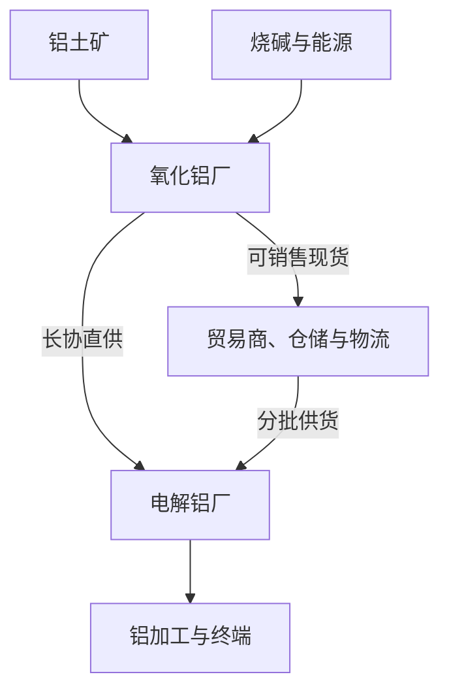

# 正式 Day 29｜氧化铝产业链：供需、成本、货物流向与库存

> 开课日期：2026-10-13（北京时间）。
> 状态：进行中；计算、数据观察和费曼作答待验收。Day28转为已讲授待补；已完成仍2/30。
> 时长：理论30分钟、案例30分钟、Excel/纸面30分钟、文华财经30分钟、费曼30分钟。
> 下列企业、价格、数量、单耗、检修和需求情景全部为教学模拟，不是今日行情、真实公司业务或行业平均数。交易规则以2026-10-13查阅的上期所页面为依据。

今天从D28的“这一笔业务怎样走完”，进入“市场上的货为什么变多或变少、为什么贵或便宜”。
目标：能把矿山、氧化铝厂、电解铝厂和贸易商联系起来；能区分供给、消耗、采购与库存；能用工厂、时间、地点和可用性解释一批货的价值。

## 1. 先认识三个不同的东西

| 名称 | 是什么 | 在本课的位置 |
|---|---|---|
| 铝土矿 | 含铝矿物的矿石，是生产氧化铝的重要原料 | 原料端 |
| 氧化铝 | 铝的氧化物，冶金级产品用于生产金属铝 | 你重点学习的贸易品种 |
| 电解铝 | 用电解工艺将氧化铝转化为金属铝 | 氧化铝的重要直接下游 |

产业链主线为铝土矿→氧化铝→电解铝→铝加工与终端。
拜耳法通过碱溶出、分离、析出和焙烧等步骤取得氧化铝；电解冶炼再将氧化铝转成金属铝。无需背化学流程，先记住“两个工厂、两次转化”。氧化铝另有非冶金用途，本课聚焦冶金级产品。

图中贸易商的作用是连接不同地点、交期、数量和付款条件，不是所有实物都必须经过贸易商。厂家可能已有长协、内部供应或已售未发的安排。
你熟悉的建筑铝型材、幕墙材料处在更后面的加工与终端环节。终端订单会沿产业链传导，但不会当天自动变成等量氧化铝采购。

依据：国际铝业协会生产与精炼说明，以及Alcoa氧化铝产品说明，见文末链接。

## 2. 氧化铝供给：从“有产能”追到“有货可卖”

| 概念 | 例子 | 不能直接推出什么 |
|---|---|---|
| 设计/建成产能 | 某厂年产能120万吨 | 不能认定今年一定产120万吨 |
| 运行产能 | 装置处于运行状态的年化规模 | 不等于已经实现的产量 |
| 实际产量 | 本周生产2万吨合格产品 | 不等于2万吨均可对外销售 |
| 对外可售量 | 扣除内部安排、已签合同等后可出售的量 | 不等于你今天可立即提走的量 |
| 按要求可交付量 | 指定品牌、数量和交期内真正能装运到客户的货 | 仍须落实合同、货权及放货条件 |

假设某厂本周产出2万吨，其中1.5万吨履行既有安排，剩下的货也可能受库存归属、质量或装车能力限制。
因此，听到“某厂有2万吨产量”时，要继续问：谁的货？哪些已售？能否接受这个品牌？何时可装车？运到客户要多久？

新装置“宣布投产”以后，还需要看爬坡、稳定生产、合格产品、合同分配和运输。公告日期与市场真正收到增量的日期可能不同。

检修消息按五项拆解：
1. 是哪一个具体工厂、哪一条装置？
2. 何时开始、预计多久，原计划还是新增变化？
3. 实际减少多少产量，是否仅调整运行负荷？
4. 原料库存、成品库存或其他供应能否弥补？
5. 消息是否已被报价和期货价格反映？

教学假设：正常日产2000吨，停产7天；无替代生产和后续补产时，本期减少14000吨产量。
这不是全国短缺14000吨的结论。还要核对其他工厂增产、进口与库存释放、需求变化。

## 3. 成本：矿、碱、能源与生产条件

氧化铝生产投入包括铝土矿、烧碱、石灰、能源等；不同矿石、工艺和工厂条件会产生不同的单位消耗与成本。Alcoa年报列示其不同设施的原料与能源消耗范围，可用来理解“不能套用一个固定成本”，不能照搬成中国某厂预算。

本课将生产成本简化分成四组：

| 成本组 | 跟踪内容 | 要问的业务问题 |
|---|---|---|
| 铝土矿 | 品质、到厂价、运输与库存 | 矿涨价是否已经影响这家厂？ |
| 烧碱等辅料 | 采购价与实际单耗 | 是否有旧合同，单耗是否改变？ |
| 能源 | 蒸汽、燃料、电力等 | 能源涨价或供应限制影响多少？ |
| 其他 | 人工、维修、折旧、环保等 | 是现金成本还是完全成本口径？ |

不要背统一百分比。比较工厂成本，先统一时间、原料条件、计量和成本口径。

独立教学例子：某厂原模型中矿石到厂价为500元/吨，单耗为每吨氧化铝2.5吨矿。
原矿石成本＝500×2.5＝1250元/吨氧化铝。
如果矿价升至540且单耗不变，矿石成本＝540×2.5＝1350，上升100。

这是原料项成本变化，不代表氧化铝售价必涨100。售价还受供需、库存、竞争、合同和预期影响。
成本上升可能先挤压利润；持续利润不足可能影响供给，但何时调整、哪些工厂调整，要另外核实。完全成本也不是短期价格必然守住的底线。

## 4. 氧化铝需求：消耗量与采购量分开

电解铝厂在生产中消耗氧化铝。需求粗算可以使用：
氧化铝生产消耗＝电解铝实际产量×氧化铝单耗。

本课假设单耗为1.9吨氧化铝/吨电解铝，仅用于练习，不是所有工厂的统一数值。
若某厂月产电解铝1万吨，生产消耗＝10000×1.9＝19000吨氧化铝。

但它本月采购多少，还要考虑期初库存、目标期末库存和其他来源。
在无其他入出库、无损耗、采购均已到库的简化条件下：
本期采购到货＝本期消耗＋期末库存－期初库存。

| 情景 | 消耗 | 期初库存 | 目标期末库存 | 所需采购到货 |
|---|---:|---:|---:|---:|
| 正常维持库存 | 19000 | 5000 | 5000 | 19000 |
| 补库 | 19000 | 5000 | 8000 | 22000 |
| 去库 | 19000 | 5000 | 3000 | 17000 |

三种情景的生产消耗一样，采购节奏不同。还要区分新签采购合同、已发运、已到货和已投入生产；在途货物不能当作已经到厂。

复产消息也要追踪：实际复产进度、产量增量、原库存、长协覆盖、现货采购缺口。
电解铝价格上涨与氧化铝上涨不是等式：铝价变化可能影响铝厂利润和生产安排，但氧化铝还面对自身供给和库存情况。

## 5. 看库存：先问统计的是什么货

| 指标 | 主要含义 | 易错点 |
|---|---|---|
| 氧化铝厂成品库存 | 上游库存商品 | 可能已售未发，未必可供你采购 |
| 电解铝厂原料库存 | 下游持有的氧化铝 | 原料库存不是电解铝成品库存 |
| 社会库存 | 报告覆盖的社会仓库等库存 | 统计范围随来源变化，不等于全国全部库存 |
| 在途库存 | 发运后尚未到目的地的货 | 应明确归属、边界和预计到达，不重复计算 |
| 交割库相关库存 | 与指定交割库有关的库存口径 | 指定地点内的货不自动成为标准仓单 |
| 标准仓单数量 | 按交易所流程形成的标准仓单 | 不是普通提货单，也不是全国可售现货总量 |

这些是分类视角，不是可以直接加总的六个互斥集合。一批货可能同时属于社会库存统计和仓单统计。厂库标准仓单也不能理解为统计日某个仓库已经堆好的同量实物。

查一份库存报告，先记四件事：产品、地点/样本、日期、单位与范围。
涉及多个来源时，先判断重叠和统计差异，再决定是否可比或可加总。

上期所氧化铝业务细则规定：交割涉及注册品牌/认可企业、质量、包装、单证等要求；仓库标准仓单还有生产日期、入库时间和有效期要求。因此“是氧化铝”“在指定仓库”均不能单独证明可用于交割。
交易单位为20吨/手，交割单位为300吨；1手不是可直接提取20吨实物的提货券。300吨对应15手只是数量换算，不代表备齐15手就满足交割资格与条件。本课先认识边界，实物交割操作留在进阶阶段。

## 6. 用简化供需平衡表做判断

先约定一个封闭的区域统计口径：区内同一品种的全部相关库存；生产与跨区流入增加库存，区内消耗与跨区流出减少库存。跨区流入计入时点一致，无损耗和其他项目。
不要在每周末再把“在途”随意加一遍。

期末库存＝期初库存＋区内产量＋区外流入－区内消耗－区外流出。

单位：吨。以下全部为模拟。

| 项目 | 第一周 | 第二周 |
|---|---:|---:|
| 期初库存 | 18000 | 18000 |
| 区内产量 | 24000 | 22000 |
| 区外流入 | 2000 | 2000 |
| 区内消耗 | 25000 | 26000 |
| 区外流出 | 1000 | 1000 |
| 本周库存变化 | 0 | −3000 |
| 期末库存 | 18000 | 15000 |

第一周：18000＋24000＋2000－25000－1000＝18000。
第二周：18000＋22000＋2000－26000－1000＝15000。

第二周相对第一周：产量少2000、消耗多1000，其余不变，共解释库存减少3000。
这个结果可作为区域边际趋紧的一项证据，但不能单独证明：
- 全国都缺货；
- 所有品牌都缺货；
- 今日期货一定上涨；
- 你以任何价格采购都能赚钱。

还应补查：剩余15000吨的地点、货权、已售比例和质量；后续复产/到货；客户真实需求；变化是否已反映在价格中。

## 7. 工厂流向：出厂价低，为什么不一定更合适？

延续你之前的山东厂家—滨州客户场景，以下厂家及报价是新模拟，不改变此前谈判条件。
两家均提供客户能够接受的品牌，均称有500吨可售；实际货权、交付能力与付款授权还待核验。

| 项目 | 厂家A | 厂家B |
|---|---:|---:|
| 出厂报价 | 2920 | 2980 |
| 运费 | 80 | 20 |
| 装卸等列示费用 | 10 | 10 |
| 列示到厂成本 | 3010 | 3010 |
| 预计到厂 | 7天 | 3天 |

假设客户4天后需要这批货：B的时间更匹配。A出厂便宜60，却由运费差额抵消；A还可能错过交期。
表中的3010未包含资金、交易、税务差异等未列项目，不能直接作为最终利润测算。

每条流向至少记录：
实际生产企业与具体厂址 → 产品/品牌与客户接受标准 → 可售货权与数量 → 装车及运输路线 → 到厂日期 → 全程成本 → 付款与发票。

“同一个集团”不等于“同一个工厂、同一种产品、同一条运输路线”。
你的价值在于找到客户可以使用、按时到达、数量和付款条件可执行的货。

## 8. 将现货与AO数据放在一起

AO是氧化铝期货；AL是铝期货。两者有产业联系，但不是同一个标的，不能默认用AL持仓完全对冲氧化铝风险。

观察时记录具体AO合约；主连/加权用于看连续走势，不作为今天计算基差的固定合约身份。
本例假设现货和期货已统一品级、地点、交期、税费口径，并在每个时点同步采样；参考始终是同一个具体AO合约。

| 时点 | 可比现货S | 参考期货F | 基差S−F |
|---|---:|---:|---:|
| 时点一 | 3020 | 3000 | ＋20 |
| 时点二 | 3010 | 2960 | ＋50 |

现货跌10，期货跌40，基差从＋20到＋50，走强30。
基差走强是相对关系，不等于现货绝对上涨。再把区域供需、现货可售量、报价与成交、期限和盘面预期放在一起解释，而不是直接归因于某条消息。

供需相对趋紧、利润与开工反馈等判断，是本课建立的条件分析，不是对当前行情的预测。

## 9. 今日两项实操

### Excel或纸面：三张表，共30分钟

1. 产业链信息表：环节、事件、日期、来源、影响量、预计持续时间、可替代因素、待核实内容。
2. 供需平衡表：按第6节计算两周期末库存、库存变化，解释−3000的原因。
3. 工厂到厂比较表：填写第7节两家成本、品牌、货权状态、交期、付款；不能只按出厂报价排序。

可用公式：
- 期末库存＝期初库存＋产量＋流入－消耗－流出；
- 库存变化＝期末库存－期初库存；
- 列示到厂成本＝出厂价＋运费＋本题列示费用；
- 基差＝同口径现货价－同一具体合约同步参考价。

实务中再加入真实统计项目和成本，不直接用简化模型替代业务凭证。

### 文华财经：数据联动，共30分钟

使用模拟环境，今天不要求新增仓位。
- 选一个非临近交割、可观察的具体AO合约；记完整代码、时间、最新、买一卖一、成交量、持仓量。
- 另记一个其他月份合约的同步价格，只用于观察月差。
- 找到一条有日期、来源、品牌/等级、地区、交货、税费口径的现货信息，标明是报价、成交还是指数。
- 能统一口径才计算基差；不能统一则写“原始价差，待调整”，列出差异。
- 若只有历史行情或缺少可信现货信息，如实注明；用第8节纸面数据练公式，不把旧价当今天的新价。
- 写三句话：我观察到什么事实；我如何解释；我还缺什么证据。

期货成交量、持仓量不是实物货量或现货库存；也不能根据“成交放量”推定某厂已经复产。

## 10. 费曼与决策练习

可以先答1—4题，不需一次完成。答案提交前不评分、不标结课。

1. 用自己的话说明铝土矿、氧化铝和电解铝的区别；贸易商通常在哪个环节提供什么价值？
2. 某厂年产能120万吨，是否代表每个月有10万吨货可卖？至少补查三项。日产2000、停产7天，在题设无替代和补产时少产多少？
3. 某厂电解铝月产10000吨，本题氧化铝单耗1.9；原料库存从5000计划增到8000：生产消耗和所需采购到货分别多少？若目标库存降到3000呢？
4. 本题矿石到厂价500涨到540、矿耗2.5不变：单位氧化铝的矿石成本增加多少？为何不能认定售价必涨相同金额？
5. 独立复算第6节两周期末库存，解释第二周少3000来自哪里。库存下降后，还缺哪三类信息才能判断是否适合采购？
6. 为什么厂库库存、社会库存、在途和仓单不能直接相加？“仓单增加3000吨＝当天新增产量3000吨”是否成立？
7. A出厂2920、运80、其他10，B出厂2980、运20、其他10：成本各多少？客户4天后要货时怎样判断，正式承诺前还需确认什么？
8. 现货3020→3010，参考AO3000→2960：两次基差、现货变化、期货变化、基差变化各多少？为何下跌与基差走强能同时发生？
9. 为什么1手AO不代表可直接提取20吨实物？300吨对应15手的算术关系，为什么不足以证明具备交割条件？
10. 写150—250字给主管的模拟市场判断：使用第二周供需和A/B报价，说明现有证据、未证实事项、可讨论方案及暂停条件。不得把意向客户当已锁销售，也不得仅凭库存下滑作采购承诺。

通过标准：能画/讲产业链，区别产能与可售量、消耗与采购，正确算供需与基差，能解释库存重叠与交割边界，给出有证据、有条件的业务判断。后续Day30进行第一次模拟交易委员会；已讲授不等于基础期已通过。

## 资料与口径

查阅日期：2026-10-13。以下用于结构、工艺与规则核对，不提供今日市场判断。
- 国际铝业协会：精炼流程（拜耳法）：https://alustory.international-aluminium.org/mining-refining/process-refining/
- 国际铝业协会：原铝生产：https://alustory.international-aluminium.org/primary-production/
- Alcoa：氧化铝产品及用途：https://www.alcoa.com/global/en/what-we-do/alumina/
- Alcoa 2025年Form 10-K：不同工厂原料与能源消耗（不作为国内工厂成本标准）：https://www.sec.gov/Archives/edgar/data/1675149/000119312526077167/aa-20251231.htm
- 上期所《氧化铝期货业务细则》（页面发布日期2026-01-01）：https://www.shfe.com.cn/regulation/exchangerules/productrules/202512/t20251231_829969.html
